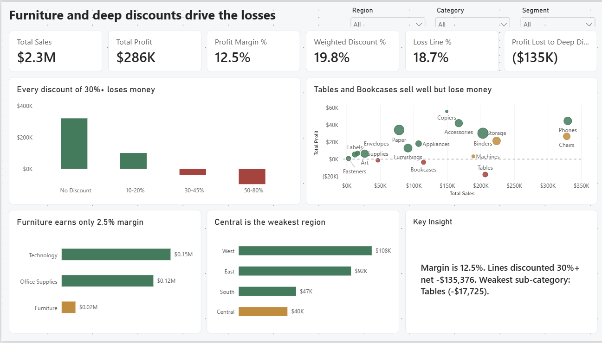
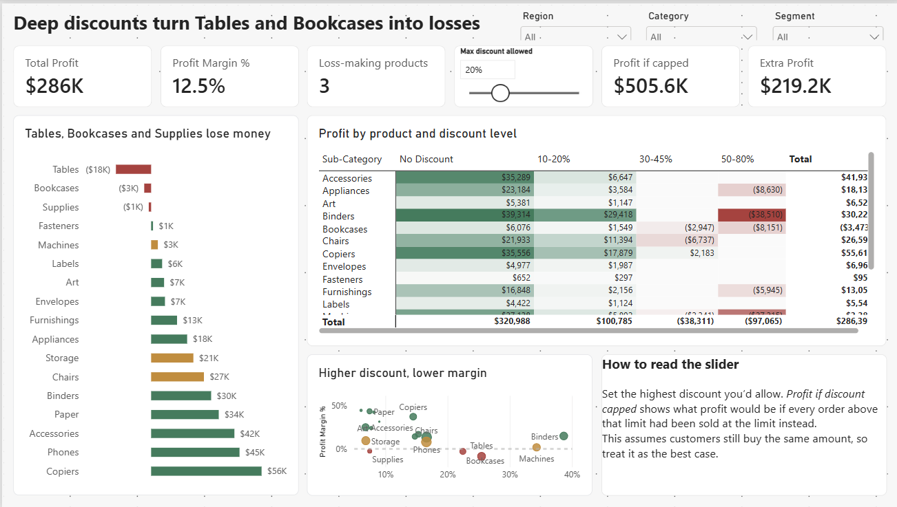
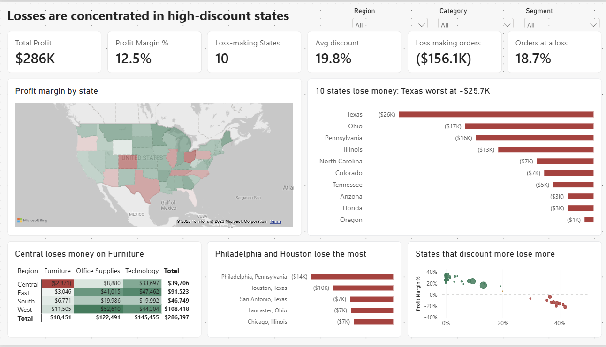
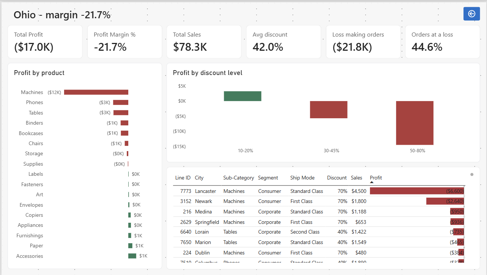

# Superstore profitability dashboard

A Power BI report that answers one question: why does this retailer keep only 12.5 cents of profit from every dollar it sells?



## In short

- Every order discounted at 30% or more loses money. Together they cost $135K, close to half of total profit.
- Furniture makes a 2.5% margin. Technology and Office Supplies make around 17%.
- 10 states lose money, led by Texas, Ohio, Pennsylvania and Illinois. Those are also the states that discount the most.

## Why I built it

Sample Superstore is a popular practice dataset, and most dashboards built on it show where sales come from. I wanted to look at the other side: where the profit goes. A business can grow sales and still lose money, so I built this report around profit and margin rather than revenue.

## What I found

**1. Discounts above 30% always lose money.**
Orders with no discount earn a 29.5% margin. At 10–20% discount, margin drops to about 12%. From 30% upwards, every discount level makes a loss, and those orders net −$135.4K in total.

**2. Furniture is the weak category.**
It brings in $742K of sales but only $18K of profit (2.5%). Tables lose $17.7K and Bookcases lose $3.5K. Supplies is the only other sub-category in the red, at −$1.2K.

**3. Losses are concentrated in a few states.**
Texas (−$25.7K), Ohio (−$17.0K), Pennsylvania (−$15.6K) and Illinois (−$12.6K) account for most of it. Their average discount is around 40%. California and New York, the two most profitable states, discount far less.

**4. Central is the weakest region.**
Its margin is 7.9%, against 13–15% in the East and West. It is also the only region where Furniture loses money (−$2.9K).

**5. Segment and ship mode don't matter much.**
Every customer segment and ship mode lands between 11% and 14% margin. The problem is pricing, not who buys or how it's delivered.

## What I'd recommend

1. **Cap discounts at 20%** and require sign-off above that. If customers kept buying the same amount, profit would go from $286K to about $506K. In reality some sales would be lost, so I'd treat that figure as the ceiling, not a forecast.
2. **Look at Furniture pricing,** starting with Tables and Bookcases in the Central region.
3. **Find out why Texas, Ohio, Pennsylvania and Illinois discount so heavily.** It could be a sales team habit, a competitor, or old stock being cleared.
4. **Leave the high-margin lines alone.** Copiers, Accessories, Paper and Labels earn 25–44% margins and don't need deep discounts to sell.

## The dashboard

The report has four pages. Each one has the same KPI strip at the top and the same Region, Category and Segment filters, synced across pages.

| Page | Question it answers | What's on it |
| --- | --- | --- |
| Overview | Are we profitable, and where is profit leaking? | KPI cards, profit by discount band, sales vs profit by product, profit by category and region, a text summary that updates with the filters |
| Profitability | Which products lose money, and at what discount? | Products ranked by profit, a product × discount heatmap, discount vs margin scatter, and a what-if slider for capping discounts |
| Regional | Where are the losses? | A US map coloured by margin, the 10 loss-making states, the worst cities, and region × category |
| Location Detail | What's happening in one state? | A drill-through page. Right-click any state to see its products, discount levels and worst orders |

| | |
| --- | --- |
|  |  |
|  | |

A few design choices I made on purpose:

- Colour only means one thing. Green is a margin of 10% or more, amber is 0–10%, red is a loss. One DAX measure controls this, so it's consistent on every chart and the map.
- Chart titles say what the chart shows ("Every discount of 30%+ loses money") instead of describing it ("Profit by Discount Band").
- Every page uses the same grid, so nothing jumps around when you switch pages.

## How I built it

### Data

`SampleSuperstore.csv` has 9,994 order lines and 13 columns: Ship Mode, Segment, Country, City, State, Postal Code, Region, Category, Sub-Category, Sales, Quantity, Discount and Profit. It covers 49 US states plus DC.

It has no order dates, order IDs or customer names, so trends over time and customer analysis weren't possible.

### Cleaning (Power Query)

- Fixed data types. Sales and Profit became decimals, Discount a percentage, and Postal Code text.
- Dropped Country, since every row says "United States".
- Added a Line ID, because there's no order number to identify each row.
- Added a City Key (city + state). Without it, Springfield in Illinois and Springfield in Missouri get counted as one city.
- Added State Location (state + ", USA") so the map puts every state in the right place.
- Grouped discounts into four bands (none, 10–20%, 30–45%, 50–80%). I put the break at 30% because that's where profit turns negative.
- Kept 17 rows that look identical. Without an order ID, I can't tell whether they're duplicates or two genuine orders.

### Model

I kept everything in one table, which is plenty for under 10,000 rows. On top of that:

- a separate `_Measures` table with 26 DAX measures
- two drill-down hierarchies: Region → State → City, and Category → Sub-Category
- a what-if parameter for the discount cap, from 0% to 80% in 5% steps

### DAX worth a look

All 26 measures are in [`dax/measures.dax`](dax/measures.dax). These four did the most work.

**Weighted discount.** A plain average of discount rates treats a $5 order the same as a $5,000 one. This measure works out how much money was actually given away, as a share of the full price.
```dax
Gross Sales = SUMX ( Superstore, DIVIDE ( Superstore[Sales], 1 - Superstore[Discount] ) )
Discount Value = [Gross Sales] - [Total Sales]
Weighted Discount % = DIVIDE ( [Discount Value], [Gross Sales] )
```

**What-if discount cap.** For every order discounted above the slider value, this recalculates profit as if it had been sold at the cap instead.
```dax
Simulated Profit =
VAR Cap = [Discount Cap Value]
RETURN
    SUMX (
        Superstore,
        VAR d = Superstore[Discount]
        VAR Gross = DIVIDE ( Superstore[Sales], 1 - d )
        RETURN Superstore[Profit] + IF ( d > Cap, Gross * ( d - Cap ), 0 )
    )
```

**Margin colour.** Returns a colour code that every chart and the map use for conditional formatting.
```dax
Margin Colour =
SWITCH ( TRUE (),
    [Profit Margin %] < 0,    "#B23A3A",
    [Profit Margin %] < 0.10, "#C98A2B",
    "#2F7D5B"
)
```

**Text summary.** Writes a one-line summary that changes with whatever filters are applied.
```dax
Headline Insight =
VAR WorstSub =
    MAXX ( TOPN ( 1, ALLSELECTED ( Superstore[Sub-Category] ), [Total Profit], ASC ), Superstore[Sub-Category] )
VAR WorstProfit = MINX ( ALLSELECTED ( Superstore[Sub-Category] ), [Total Profit] )
RETURN
    "Margin is " & FORMAT ( [Profit Margin %], "0.0%" )
        & ". Lines discounted 30%+ net " & FORMAT ( [Profit Lost to Deep Discounts], "$#,0;-$#,0" )
        & ". Weakest sub-category: " & WorstSub & " (" & FORMAT ( WorstProfit, "$#,0;-$#,0" ) & ")."
```

## Checking the numbers

Before formatting anything, I compared the report's totals against the source CSV.

| Measure | Value |
| --- | --- |
| Total sales | $2,297,201 |
| Total profit | $286,397 |
| Profit margin | 12.5% |
| Units sold | 37,873 |
| Order lines | 9,994 |
| Weighted discount | 19.8% |
| Loss-making states | 10 |
| Loss-making sub-categories | 3 |
| Profit with a 20% discount cap | $505,588 |

## Limitations

- There are no dates in this dataset, so I couldn't look at trends or seasonality. The full Superstore dataset has order dates, and a trends page would be the obvious next step.
- The discount cap assumes customers would buy the same amount at a smaller discount. Some wouldn't, so the real gain would be lower.
- High discounts and losses go together very clearly, but some of those discounts could be deliberate, such as clearing old stock that would otherwise be written off. The data can't tell us that.

## What's in this repo

```
├── Superstore_Profitability.pbix   # the Power BI report
├── data/
│   └── SampleSuperstore.csv        # source data
├── dax/
│   └── measures.dax                # all 26 measures
├── images/                         # screenshots of each page
└── README.md
```

## How to open it

1. Install [Power BI Desktop](https://powerbi.microsoft.com/desktop/). It's free, but Windows only.
2. Open `Superstore_Profitability.pbix`.
3. If it can't find the data, go to Home → Transform data → Data source settings and point it at `data/SampleSuperstore.csv`.
4. To try the drill-through, go to the Regional page, right-click any state and choose Drill through → Location Detail.

**Built with:** Power BI Desktop, Power Query, DAX
